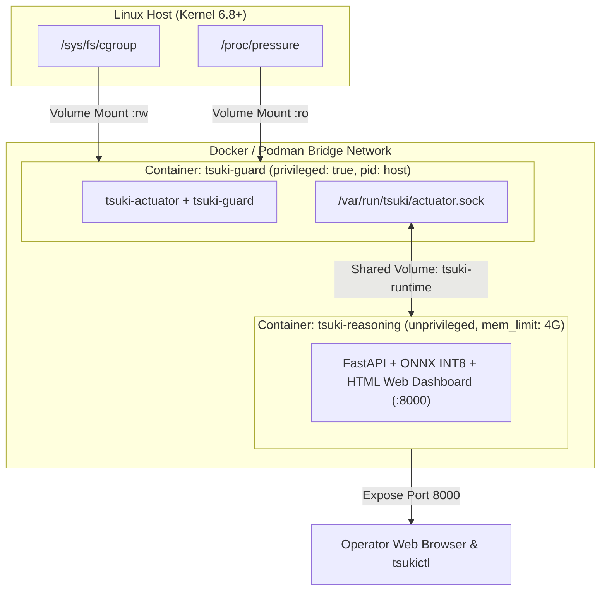
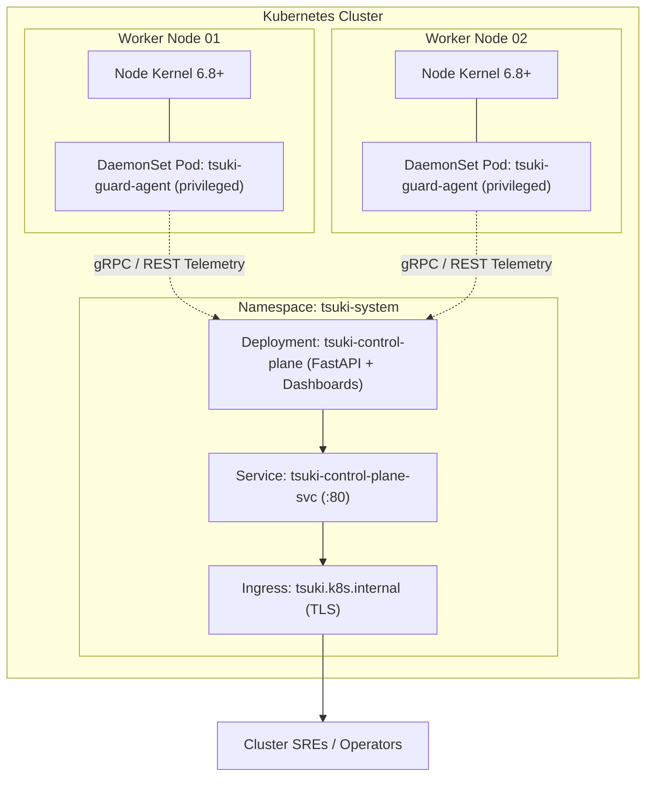

# Alternative Deployment Methods for Tsuki: Frontend & Backend

While native systemd slices provide the highest possible determinism and lowest latency for single bare-metal nodes, enterprise production environments often require alternative deployment models.

This guide outlines **4 alternative architectures** for deploying Tsuki's Frontend (Web Control Plane) and Backend (Guard & Reasoning Planes), complete with trade-offs, architecture diagrams, and ready-to-run configurations.

---

## 1. Comparative Deployment Paradigm Matrix

| Architecture Pattern | Frontend Tier | Backend Guard Plane | Backend Reasoning Plane | Best Used For |
|---|---|---|---|---|
| **1. Native Systemd (Baseline)** | Static FastAPI (:8000) | `tsuki-guard.slice` (Host) | `tsuki-reasoning.slice` | Dedicated Linux servers, bare-metal high-throughput nodes |
| **2. Containerized (Docker / Podman)** | Nginx Container / FastAPI | Privileged Container (`--pid=host`) | Bounded Container (4GB cap) | Local development, staging clusters, quick CI/CD validation |
| **3. Kubernetes Fleet (K8s)** | Ingress / Service | Node DaemonSet (`hostPID: true`) | Replicated Deployment | Multi-node Kubernetes clusters (EKS, GKE, Bare-Metal K8s) |
| **4. Decoupled Edge / Cloud CDN** | Cloudflare Pages / S3 CDN | On-Node Agent Binary | Cloud GPU / Relay Instance | Fleet of hundreds of distributed nodes, multi-region setups |
| **5. Immutable OS Appliance** | Integrated Web UI | `systemd-sysext` Overlay | Sandboxed Systemd Extension | Flatcar, Talos, Fedora CoreOS, declarative immutable clouds |

---

## 2. Method A: Containerized Deployment (Docker & Podman Compose)

In containerized deployments, the strict separation between Guard Plane (host privileged) and Reasoning Plane (unprivileged, memory-capped) is achieved through container isolation and shared IPC volumes.



### Architecture Blueprint
- **Guard Container ([deploy/docker/Dockerfile.guard](file:///home/hiyansh-sharma/Documents/OS_Project/deploy/docker/Dockerfile.guard))**:
  - Runs compiled Rust binaries with `privileged: true`, `pid: host`, and `network_mode: host`.
  - Mounts host `/sys/fs/cgroup` and `/proc/pressure`.
  - Binds `/var/run/tsuki/actuator.sock` into a shared Docker named volume.
- **Reasoning & Frontend Container ([deploy/docker/Dockerfile.reasoning](file:///home/hiyansh-sharma/Documents/OS_Project/deploy/docker/Dockerfile.reasoning))**:
  - Standard unprivileged Python container running FastAPI on port `8000`.
  - Directly serves all web views (`cockpit.html`, `bootloader.html`, `audit.html`, etc.).
  - Bounded at `4096M` memory limit so it can never trigger host OOM.

### Quickstart Execution
```bash
cd deploy/docker
docker compose up -d
```
Access the dashboard at `http://localhost:8000/cockpit`.

---

## 3. Method B: Kubernetes Fleet (DaemonSet + Centralized Ingress)

For Kubernetes environments, Tsuki is split into a **Node-Level DaemonSet** for kernel telemetric enforcement, and a **Centralized Control Plane Deployment** for aggregation and UI access.



### Manifests & Structure
- **DaemonSet ([deploy/k8s/tsuki-daemonset.yaml](file:///home/hiyansh-sharma/Documents/OS_Project/deploy/k8s/tsuki-daemonset.yaml))**:
  - Runs on every node with `hostPID: true`, `hostNetwork: true`, and `privileged: true`.
  - Directly attaches eBPF tracepoints and polls node-level PSI.
- **Control Plane ([deploy/k8s/tsuki-control-plane.yaml](file:///home/hiyansh-sharma/Documents/OS_Project/deploy/k8s/tsuki-control-plane.yaml))**:
  - Horizontal deployment providing the web dashboard and REST API.
  - Fronted by standard K8s Ingress with automatic `cert-manager` TLS termination.

---

## 4. Method C: Decoupled Edge / Cloud CDN Model

This architecture separates the static presentation tier from the on-premise execution plane:

```mermaid
flowchart LR
    Browser["Operator Browser"] -->|HTTPS CDN Fetch (0ms latency)| Cloudflare["Global CDN / Cloudflare Pages<br>(cockpit.html, bootloader.html, etc.)"]
    Browser -->|Secure Authenticated API Calls| Relay["API Gateway / Tailscale / Cloudflare Tunnel"]
    Relay -->|mTLS / WireGuard| NodeAPI["Host FastAPI Daemon (:8000)"]
    NodeAPI -->|UDS 0600| Guard["Rust Guard Plane (Kernel)"]
```

### Implementation Details:
1. **Frontend on Edge CDN**:
   - The HTML files (`cockpit.html`, `bootloader.html`, `audit.html`, `telemetry.html`, `settings.html`) are zero-dependency static files that compile directly to any CDN (Cloudflare Pages, AWS S3 + CloudFront, or Firebase Hosting).
   - Assets (`/assets/logo.png`) are globally cached at edge nodes.
2. **Backend API Tunneling**:
   - The on-node backend runs headless with `uvicorn --host 127.0.0.1 --port 8000`.
   - Exposed securely to the browser via **Tailscale Funnel**, **Cloudflare Zero Trust Tunnel**, or an internal VPN, avoiding public exposure of port `8000`.

---

## 5. Method D: Immutable OS Appliance (`systemd-sysext`)

For modern immutable Linux operating systems (Flatcar Container Linux, Fedora CoreOS, openSUSE MicroOS):

1. **System Extension Overlay**:
   - Compile Tsuki release binaries and bundle into a SquashFS image `/opt/extensions/tsuki.raw`.
   - Activated automatically at boot via `systemd-sysext merge`.
2. **Zero Host Mutation**:
   - Host `/usr` remains read-only.
   - All runtime state is strictly confined to ephemeral `/var/run/tsuki` and persistent `/var/lib/tsuki`.

---

## 6. Architecture Selection Guide

| If your organization uses... | Recommended Method | Primary Benefit |
|---|---|---|
| **Standard Linux VMs / Bare-Metal** | **Native Systemd** ([deploy/deploy.sh](file:///home/hiyansh-sharma/Documents/OS_Project/deploy/deploy.sh)) | Lowest overhead ($<0.2\%$ CPU), pure $100\,\text{Hz}$ latency |
| **Docker Swarm / Single Docker Hosts** | **Docker Compose** ([deploy/docker/docker-compose.yml](file:///home/hiyansh-sharma/Documents/OS_Project/deploy/docker/docker-compose.yml)) | Instant spin-up, zero host dependency pollution |
| **Kubernetes (EKS / GKE / On-Prem)** | **K8s DaemonSet** ([deploy/k8s/](file:///home/hiyansh-sharma/Documents/OS_Project/deploy/k8s/)) | Cluster-wide fleet governance and unified ingress |
| **Distributed Remote Edge Nodes** | **Decoupled CDN + Tailscale** | Centralized web access with air-gapped node security |
