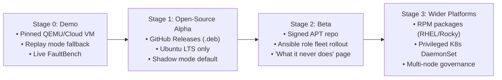
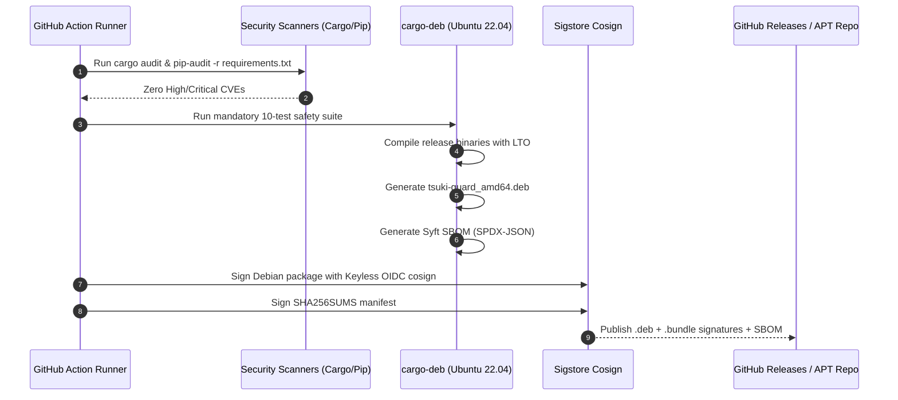
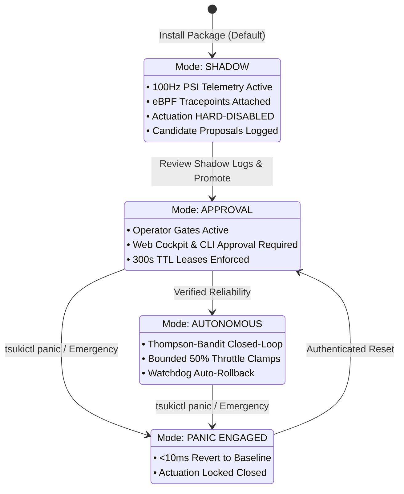

# Tsuki (月) Master Production Deployment Plan

> **Core Principle**: Tsuki runs on the host because it requires low-level access to Linux Pressure Stall Information (PSI), cgroup v2 controller hierarchies, and eBPF CO-RE tracepoints. It ships as a native package with systemd unit files and cgroup resource slices — **not as a normal container app**.
> 
> Deployment follows the same phased governance that Tsuki applies to its own remediations: **shadow mode first, then operator approval gating, then bounded autonomy**.

---

## 1. What Gets Deployed

Tsuki is partitioned into discrete, independently versionable artifacts to prevent dependency coupling and protect host stability:

| Component | Technology | Delivery Mechanism & Target Path | Security & Operational Bounds |
|---|---|---|---|
| **Guard Plane** | Rust (`tsuki-guard`, `tsuki-actuator`, `tsuki-rollbackd`) | Single `.deb` package for Ubuntu LTS (built via `cargo-deb`). Installs to `/usr/local/bin/`, `/etc/tsuki/`, and `/etc/systemd/system/`. | Memory-locked ($42\,\text{MB}$ RSS via `mlockall`), `OOMScoreAdjust=-900`, `0600` socket permissions. |
| **Reasoning Plane** | Python (`tsuki_agent`, `tsuki_rag`, `tsuki_api`) | Packaged virtualenv or wheel with pinned, hashed lockfile (`requirements-lock.txt`). Staged under `/opt/tsuki/`. **Optional and installable separately**. | Sacrificial slice (`tsuki-reasoning.slice`, `OOMScoreAdjust=500`, max memory capped at $4\,\text{GB}$). |
| **Models & Knowledge Index** | ONNX Runtime INT8 TCN ($4.2\,\text{MB}$) & SQLite index (`index.db`) | Versioned, cryptographic tarballs (`models-v1.0.tar.gz.sig`). Downloaded to `/var/lib/tsuki/models/`. | Decoupled from binaries; models can be updated or rolled back without restarting or touching daemons. |
| **Local LLM** | Ollama (`llama3.1:8b`) | User-installed on host via official Ollama package; **Tsuki only configures it** via local loopback (`http://127.0.0.1:11434`). | Tsuki does not package or ship heavy LLM runtimes inside its core binaries. |
| **Web Dashboard** | Vanilla JS / Tailwind / Material Symbols | Served directly by local FastAPI service (`/opt/tsuki/*.html`). | **Binds to `127.0.0.1:8000` only**, protected by `X-Tsuki-Token` bearer authentication. **No remote public exposure by default**. |
| **CMD CLI Utility** | Python / Rust (`tsukictl`) | Packaged in `.deb` to `/usr/local/bin/tsukictl`. | Direct local UDS IPC communication; zero external network requirement. |
| **Offline Tooling** | Training pipelines, OS-FaultBench arena | Container images (`ghcr.io/snoxx-tech/tsuki-faultbench:latest`) for CI and dev machines. | **Never deployed on protected production hosts**. |

---

## 2. Four-Stage Production Rollout



### Stage 0: Hackathon & Evaluation Demo
- **Goal**: Reliable, deterministic live demonstration without environmental variance.
- **Deployment**: Pinned VM image (QEMU or Ubuntu 24.04/22.04 LTS cloud VM with Linux 6.8+ kernel).
- **Fallbacks**: Pre-recorded trace replay mode and deterministic snapshot synthetic injection (`demo/run_demo.sh`).

### Stage 1: Open-Source Alpha
- **Goal**: Real-world operator evaluation and telemetry collection in safe environments.
- **Deployment**: Published GitHub Releases with signed `.deb` packages and source tarballs for Ubuntu LTS.
- **Enforcement**: **Shadow mode active by default** (`mode = "shadow"`). Telemetry streams and candidate remediations are logged, but zero cgroup writes occur.

### Stage 2: Production Beta
- **Goal**: Enterprise adoption, auditable automated rollout, and operator trust.
- **Deployment**:
  - Official signed APT repository (`apt.tsuki.systems`).
  - Automated Ansible role under [deploy/ansible/tsuki_role/](file:///home/hiyansh-sharma/Documents/OS_Project/deploy/ansible/tsuki_role/) for idempotent fleet provisioning.
  - Published public benchmark datasets from OS-FaultBench.
  - Official transparency contract: [docs/WHAT_IT_NEVER_DOES.md](file:///home/hiyansh-sharma/Documents/OS_Project/docs/WHAT_IT_NEVER_DOES.md).

### Stage 3: Wider Platforms & Clusters
- **Goal**: Heterogeneous enterprise fleet and cluster management.
- **Deployment**:
  - RPM packaging for Fedora, RHEL, and Rocky Linux.
  - Dedicated privileged Kubernetes DaemonSet ([deploy/k8s/tsuki-daemonset.yaml](file:///home/hiyansh-sharma/Documents/OS_Project/deploy/k8s/tsuki-daemonset.yaml)), accompanied by a dedicated safety review for cluster multi-tenancy.

---

## 3. CI/CD & Supply Chain Security

Every package release is verified using a rigorous, automated supply chain pipeline defined in [.github/workflows/release.yml](file:///home/hiyansh-sharma/Documents/OS_Project/.github/workflows/release.yml):



1. **Vulnerability Auditing**: Pre-release CI runs `cargo audit` on Rust crates and `pip-audit` against hashed requirements.
2. **Keyless Signing (Sigstore Cosign)**: Releases are signed using Sigstore Cosign with OIDC workload identity. Operators verify `.deb` packages before installation:
   ```bash
   cosign verify-blob \
     --bundle tsuki-deb.cosign.bundle \
     --certificate-identity "https://github.com/snoxx-tech/tsuki/.github/workflows/release.yml@refs/tags/v0.1.0" \
     --certificate-oidc-issuer "https://token.actions.githubusercontent.com" \
     tsuki-guard_0.1.0_amd64.deb
   ```
3. **Software Bill of Materials (SBOM)**: Every release generates an SPDX-JSON SBOM using Anchore Syft.
4. **No Unverified Installers**: Tsuki explicitly avoids dangerous `curl | sh` scripts. All installation instructions mandate package checksum or GPG/Cosign verification.

---

## 4. Safe Operation & Post-Installation Lifecycle



### 1. Default Safety Posture
- Initial installation strictly sets `mode = "shadow"` in `/etc/tsuki/tsuki.toml`.
- Actuation writes to `/sys/fs/cgroup` are physically rejected by the actuator state machine.
- Protected cgroups (`sshd.service`, `systemd-journald.service`, `tsuki-*.service`) are pre-filled in the configuration and immutable.

### 2. Promotion Protocol
- Operators monitor Tsuki in shadow mode for a minimum burn-in period (e.g., 24 to 72 hours).
- The shadow log (`/var/run/tsuki/snapshots/`) is audited to review candidate actions Tsuki would have taken.
- Once verified, the operator promotes the node to `approval` mode in `/etc/tsuki/tsuki.toml`.

### 3. Self-Rollback & Crash Resilience
- Systemd automatically restarts `tsuki-guard` and `tsuki-actuator` within $2\,\text{seconds}$ on unexpected exit.
- Active cgroup modifications are tracked in the transactional journal `/var/lib/tsuki/rollback.journal`.
- If the primary daemon crashes or fails to heartbeat, the standalone `tsuki-rollbackd` watchdog restores baseline limits automatically.
- The `tsukictl panic` switch remains globally armed and callable across every stage.

### 4. Telemetry Privacy
- Tsuki does not transmit any telemetry to cloud servers.
- All PSI metrics, eBPF logs, and HMAC audit records remain strictly on the local machine.

---

## 5. What to Avoid (Anti-Patterns)

| Anti-Pattern | Why It Is Dangerous | Tsuki Engineering Rule |
|---|---|---|
| **Running Guard in Unprivileged Containers** | Hides `/proc/pressure`, masks root `/sys/fs/cgroup`, and drops required `CAP_SYS_RESOURCE`. | Must run natively on the host under `tsuki-guard.slice`. |
| **Auto-Updating Models or Daemons** | Unannounced updates can introduce unexpected behavioral drift or regression during active node incidents. | Updates must be manual, versioned `.deb` or model tarballs. |
| **Actuation On by Default** | Applying automated cgroup throttles without understanding baseline workload behavior can trigger accidental latency spikes. | Always boot in shadow mode first. |
| **Unauthenticated Remote Web Exposure** | Exposing control plane port `8000` to public networks invites unauthorized actuation. | Bind to `127.0.0.1` only; access remotely via SSH tunnel or authenticated VPN. |
